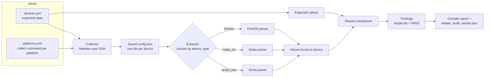
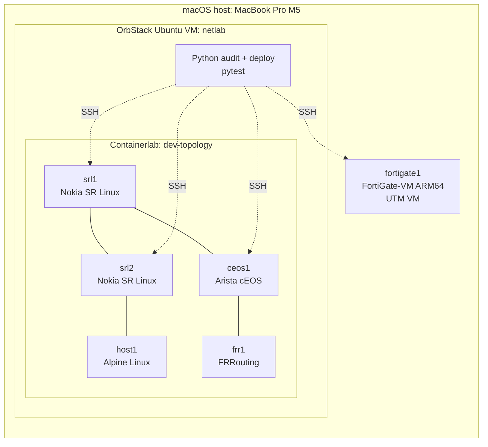

# Multi Vendor Network Compliance Audit

A network configuration audit and deployment framework, built and tested against a hybrid virtual platform of containers and VMs. It collects configuration from devices over SSH, extracts the relevant settings with a per platform parser, and compares them with an inventory of what each device *should* have. Findings are mapped to Australian Information Security Manual (ISM) controls.

**Platforms in the lab:** Arista EOS, Nokia SR Linux, Fortinet FortiOS, FRRouting, Linux.
**Platforms planned:** Juniper and Cisco (pending image access).

[](https://github.com/princesoin/illuminare-networks-network-compliance-lab/actions/workflows/ci.yml)

## Contents

- [Demo](#demo)
- [What it does](#what-it-does)
- [Example output](#example-output)
- [Architecture](#architecture)
- [The lab](#the-lab)
- [Vendor and platform coverage](#vendor-and-platform-coverage)
- [Tech stack](#tech-stack)
- [Repository layout](#repository-layout)
- [Quick start](#quick-start)
- [Adding a platform or a check](#adding-a-platform-or-a-check)
- [Testing and CI](#testing-and-ci)
- [Security model](#security-model)
- [Lab engineering notes](#lab-engineering-notes)
- [Known limitations](#known-limitations)
- [Roadmap](#roadmap)

## Demo

Video walkthrough: **recording in progress.**

**What the demo covers:**

1. The lab topology deployed with Containerlab, plus the FortiGate VM running in UTM.
2. The deploy program pushing the NTP configuration from Jinja templates, then a clean audit.
3. `python audit.py` showing PASS across Arista, Nokia and Fortinet.
4. Changing an expected NTP server in the inventory and re-running to show a FAIL with both the missing and the unexpected server named.

## What it does

1. Reads an inventory (`devices.yml`) listing each device, its platform, and the settings it is expected to have.
2. Connects to each device with Netmiko and runs a platform specific `show` command taken from `platforms.yml`.
3. Saves the collected output to a file named after the inventory entry, so evidence keeps a stable identity even when a device's IP address changes.
4. Runs each registered check. An **extractor** for that platform pulls the actual values out of the config text, then a shared **comparison** reports anything missing or unexpected.
5. Prints PASS or FAIL per device and check, and writes `master_audit_results.json`.
6. Separately, a **deploy** program renders per vendor Jinja templates and pushes configuration, so the same inventory that drives the audit also drives the fix.

Devices that time out or reject the login are listed as unreachable and skipped, so one bad device does not stop the run.

## Example output

```
[ceos1] PASS ntp_check
[srl1] FAIL ntp_check: ['Missing NTP Server 10.0.0.57', 'Unexpected NTP Server 10.0.0.55']
[srl2] PASS ntp_check
[fortigate1] PASS ntp_check
Unreachable devices: []
```

The `srl1` failure is deliberate: the inventory was changed to expect `10.0.0.57` while the device is configured with `10.0.0.55`. The check reports both sides of the mismatch, which is what an assessor needs to see. 

## Architecture



### Extract and compare

The central design decision is splitting each check into two parts.

- **Extract** is vendor-specific, because every platform prints the same fact differently:

  | Platform | Collect command | Line the extractor reads |
  |---|---|---|
  | Arista EOS | `show running-config \| include ntp` | `ntp server 10.0.0.1 prefer`, `ntp server vrf MGMT 10.0.0.1` |
  | Nokia SR Linux | `info flat from running / system ntp` | `set / system ntp server 10.0.0.1` |
  | Fortinet FortiOS | `show system ntp` | `set server "10.0.0.1"` inside nested `config ntpserver` / `edit` blocks |

- **Compare** is vendor neutral. It takes the list found and the list expected and returns findings. Adding a platform never touches it.

### Other design decisions

- **Checks return data and do not print.** `check_ntp` returns a list of findings, where an empty list means PASS. Printing and JSON output happen in the audit program, so checks are easy to unit test and the reporting layer can grow (more result states, other formats) without editing any check.
- **Unsupported platforms raise an error** instead of returning an empty list, because an empty list would read as "no servers configured" and produce a false finding.
- **A dictionary maps each platform to its extractor**, so adding a platform is one new function and one new dictionary entry, with no growing `if/elif` chain.
- **A check registry** (`ALL_CHECKS`) holds each check's function, description, ISM control reference and fix text, which is the structure the reporting layer reads.
- **Audit and deploy are separate programs.** The audit collects and checks. The deploy program changes configuration. Keeping them apart means the audit can be run and reviewed without any change path to a device.
- **Inventory name is the device identity**, not its address. Saved evidence and results stay attached to `fortigate1` even when DHCP moves the VM.

### Control mapping

| Check | ISM control | What it proves |
|---|---|---|
| `ntp_check` | ISM-0988 | The device is configured to use the expected time sources, so event logs carry a consistent time. |

This check proves **configuration**, not live synchronisation. Further checks (centralised logging, insecure management protocols) are on the roadmap.

## The lab

A hybrid lab runs on a single MacBook Pro (M5, 16 GB). The Containerlab nodes run inside an Ubuntu VM under OrbStack, and the FortiGate runs as a separate UTM VM, bridged to the lab network.



| Node | Platform | Image | Runs as |
|---|---|---|---|
| `srl1`, `srl2` | Nokia SR Linux | `ghcr.io/nokia/srlinux` | Container |
| `ceos1` | Arista cEOS | `ceos` (ARM64 build imported from Arista) | Container |
| `frr1` | FRRouting | `quay.io/frrouting/frr` | Container |
| `host1` | Linux (Alpine) | `alpine` | Container |
| `fortigate1` | Fortinet FortiOS 8.0.1 | FortiGate-VM ARM64 KVM build | UTM (QEMU) VM |

Container images are pinned in `labs/dev/dev-topology.clab.yml`. Vendor images (cEOS, FortiGate) are licensed downloads and are not included in this repository.

## Vendor and platform coverage

| Vendor / platform | In lab topology | Audited (NTP) | Deployed via templates | Notes |
|---|---|---|---|---|
| **Arista EOS** | Yes (cEOS) | Yes | Yes | Handles `vrf` syntax and ignores `no ntp server` lines |
| **Nokia SR Linux** | Yes (2 nodes) | Yes | Yes | Flat `info flat` output; candidate and commit workflow on deploy |
| **Fortinet FortiOS** | Yes (UTM VM) | Yes | Yes | Nested config blocks; the reason the extract/compare split exists |
| **FRRouting** | Yes | Not yet | No | NTP runs on the host, not in FRR's config, so the NTP check is not applicable. Routing checks planned. |
| **Linux (Alpine host)** | Yes | Not yet | No | Test endpoint for the lab links |
| **Juniper** | No | Planned | Planned | cRPD is the native ARM option. Pending image access. |
| **Cisco** | No | Planned | Planned | Most Cisco images are x86 VMs and need an x86 host. Pending image access. |

## Tech stack

| Area | Tool | Used for |
|---|---|---|
| Language | Python 3 | Collector, checks, deploy program |
| SSH automation | Netmiko | Device connections, show commands, config push |
| Inventory | PyYAML | Loading `devices.yml` and `platforms.yml` |
| Templating | Jinja2 | Per-vendor configuration templates for deployment |
| Testing | pytest | Unit tests with saved, redacted config samples |
| Linting | ruff | Error and style rules (`E`, `F`), run locally and in CI. Google docstring rules are planned. |
| CI | GitHub Actions | Runs ruff and pytest on every push and pull request |
| Lab orchestration | Containerlab | Deploying the container topology |
| Containers | Docker | Runtime for SR Linux, cEOS, FRR and Alpine nodes |
| Container host | OrbStack | Ubuntu 26.04 (arm64) Linux VM named `netlab` |
| Virtualisation | UTM (QEMU backend) | FortiGate-VM, which has no container image |
| Dev environment | VS Code with Remote-SSH | Editing and running code inside the Linux VM |
| Source control | Git, GitHub, GitHub CLI (`gh`) | Version control and hosting |
| History hygiene | git-filter-repo | Removing credentials and collected configs from history |
| Package management | Homebrew (macOS), pip and venv (Python) | Tooling and dependencies |
| Diagrams | Mermaid | Architecture and lab diagrams in this README |
| Host | MacBook Pro, Apple M5, 16 GB | Runs the whole lab |

**Planned:** `concurrent.futures` for threaded collection, and a timing comparison against a Java (JSch) implementation.

## Repository layout

```
.github/workflows/
  ci.yml                       GitHub Actions: ruff and pytest on every push
ruff.toml                      Lint configuration
requirements.txt               Python dependencies (used locally and by CI)
inventory/
  devices.example.yml          Example inventory (copy to devices.yml)
  platforms.yml                Per platform collect command, template folder, error patterns
labs/dev/                      Containerlab topology and device startup configs
templates/                     Jinja templates for the deploy program, one folder per vendor
scripts-dev/
  audit.py                     Collect configs and run checks
  checks.py                    Check registry and the function that runs every check
  check_modules/
    ntp_check.py               NTP extractors, platform dictionary, check_ntp
  deploy_configuration_dev.py  Render templates and push config (changes devices)
  tests/
    test_ntp_check.py          pytest tests for the extractors and check_ntp
```

## Quick start

Requires Python 3.10 or later, and a lab with reachable devices.

```bash
git clone https://github.com/princesoin/illuminare-networks-network-compliance-lab.git
cd illuminare-networks-network-compliance-lab
python3 -m venv .venv
source .venv/bin/activate
pip install -r requirements.txt

cp inventory/devices.example.yml inventory/devices.yml
# Edit devices.yml: set each device's address and credentials.
```

Run the tests:

```bash
cd scripts-dev
python -m pytest -v
```

Run the audit:

```bash
cd scripts-dev
python audit.py
```

Run the deploy program (**this changes device configuration**):

```bash
cd scripts-dev
python deploy_configuration_dev.py
```

`inventory/devices.yml` is gitignored and must never be committed, because it holds credentials.

### Inventory format

Each device has connection details (passed straight to Netmiko) and `vars` describing the state it should be in:

```yaml
srl1:
  connection:
    device_type: nokia_srl
    host: <address or hostname>
    username: <user>
    password: <password>
  vars:
    hostname: srl1
    ntp_servers:
      - 10.0.0.55
```

For Arista, an entry such as `10.0.0.126 prefer` is accepted. The audit compares only the address, and the deploy template uses the full entry.

## Adding a platform or a check

**A new platform for an existing check** (for example, Juniper)

1. Write `extract_ntp_<platform>(output)` in `check_modules/ntp_check.py`. It takes config text and returns a list of address strings.
2. Add it to `NTP_EXTRACTORS`, keyed by the Netmiko `device_type`.
3. Add the platform to `inventory/platforms.yml` with its collect command and error pattern.
4. Add tests with a redacted sample of the real output, including the awkward lines.

**A new check** (for example, logging)

1. Create `check_modules/<name>_check.py` with its extractors, a platform dictionary and a `check_<name>` function that returns a list of findings.
2. Register it in `ALL_CHECKS` in `checks.py` with its description and control reference.

## Testing and CI

Tests feed saved sample config text to the extractors and assert on the returned lists, one test per case. Current coverage:

- FortiOS extraction, with quotes removed
- Arista extraction including a `vrf` line, with `no ntp server` lines ignored
- Unknown platform raises `ValueError`

Beyond unit tests, the audit has been verified end to end against the live lab. Matching configuration passes, and a deliberately wrong inventory entry fails with the exact missing and unexpected servers on all platforms listed.

### Continuous integration

Every push to `main`, and every pull request, runs a GitHub Actions workflow (`.github/workflows/ci.yml`) on a clean Ubuntu runner:

1. Check out the repository.
2. Install Python and the packages in `requirements.txt`.
3. Lint with `ruff check .`.
4. Run `python -m pytest -v` from `scripts-dev`.

The runner has no route to the lab and no `devices.yml`, so CI exercises the parsers and check logic against the sample config text only. It cannot audit real devices, which is why the samples are kept close to real device output. The workflow needs no secrets.

Run the same two checks locally before pushing:

```bash
ruff check .
cd scripts-dev && python -m pytest -v
```

## Security model

- **Credentials stay out of git.** `devices.yml`, collected configs (`*.running_config.txt`) and generated results are gitignored.
- **Audit and deploy are separate programs** with different intent: one only reads, one writes.
- **Samples are redacted** before they are committed. Hostnames derived from device serial numbers are replaced.
- **Collected configs are treated as sensitive** whatever their content. Do not commit them or paste them into issues or chats.

Do not run this tool against devices you are not authorised to audit.

## Lab engineering notes

Getting a mixed container and VM lab working on Apple silicon surfaced several constraints, recorded here because they decide which tools can run where.

- **No `/dev/kvm` in OrbStack.** Only container based nodes can run in the netlab VM, so VM based images cannot run there.
- **ARM64 container network OSes** are limited to SR Linux, cEOS, FRR and Juniper cRPD. Most others (Cisco, Palo Alto, vSRX) are x86 VMs and need an x86 host.
- **FortiGate runs as a standalone UTM VM** with the QEMU backend. Running the ARM FortiGate nested inside a Linux VM under KVM hung after the UEFI handoff in testing, while the non nested UTM VM boots normally.
- **vrnetlab is amd64-only**, so it cannot build the VM based nodes on an ARM host (Looking into alt for this.)
- **FortiGate evaluation licence limits** apply (1 vCPU, 2 GB RAM). Exceeding them invalidates the licence.
- **cEOS is not on Docker Hub.** The ARM64 image is downloaded from Arista and imported with `docker import`.

These findings are intended as a write up for the Containerlab and vrnetlab communities.

## Known limitations

- **Current NTP check proves configuration, not time synchronisation.**
- **Collect commands are filtered** (for example `include ntp`), so saved files are fragments, not full configs. Full config collection is planned.
- **Paths are hardcoded** in the scripts and will move to `pathlib`.
- **Result states are pass and fail only.** "Not applicable" (for example NTP on FRR) and "error" are not yet distinguished.
- **An unsupported platform stops the whole audit** rather than being reported for that device alone.
- **Lint coverage is partial.** Ruff runs the `E` and `F` rules with long line checks off. Docstring rules are not enforced yet.

## Roadmap

- [x] NTP check on Arista EOS, Nokia SR Linux and FortiOS
- [x] Per platform extractors with a shared comparison
- [x] Unit tests for extractors and platform dispatch
- [x] Hybrid lab: containers plus a FortiGate VM
- [x] Separate audit and deploy programs with Jinja templates
- [x] GitHub Actions running pytest and ruff on every push
- [ ] Full config collection and evidence metadata (timestamp, firmware version, collect command)
- [ ] Result states: pass, fail, not applicable, error
- [ ] Logging and Telnet/SSH checks
- [ ] Juniper and Cisco platform support (pending images)
- [ ] Threaded collection and a timing comparison with a Java (JSch) implementation
- [ ] AI layer that explains findings and drafts remediated configuration from structured results only, never seeing raw configs and never deciding pass or fail

## Author

Prince Soin.