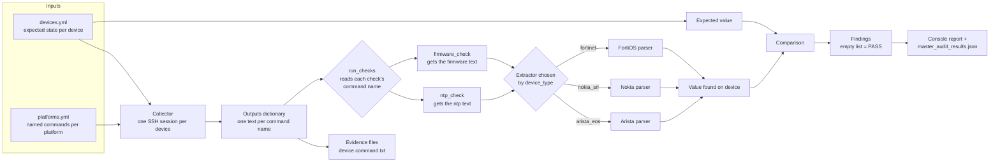
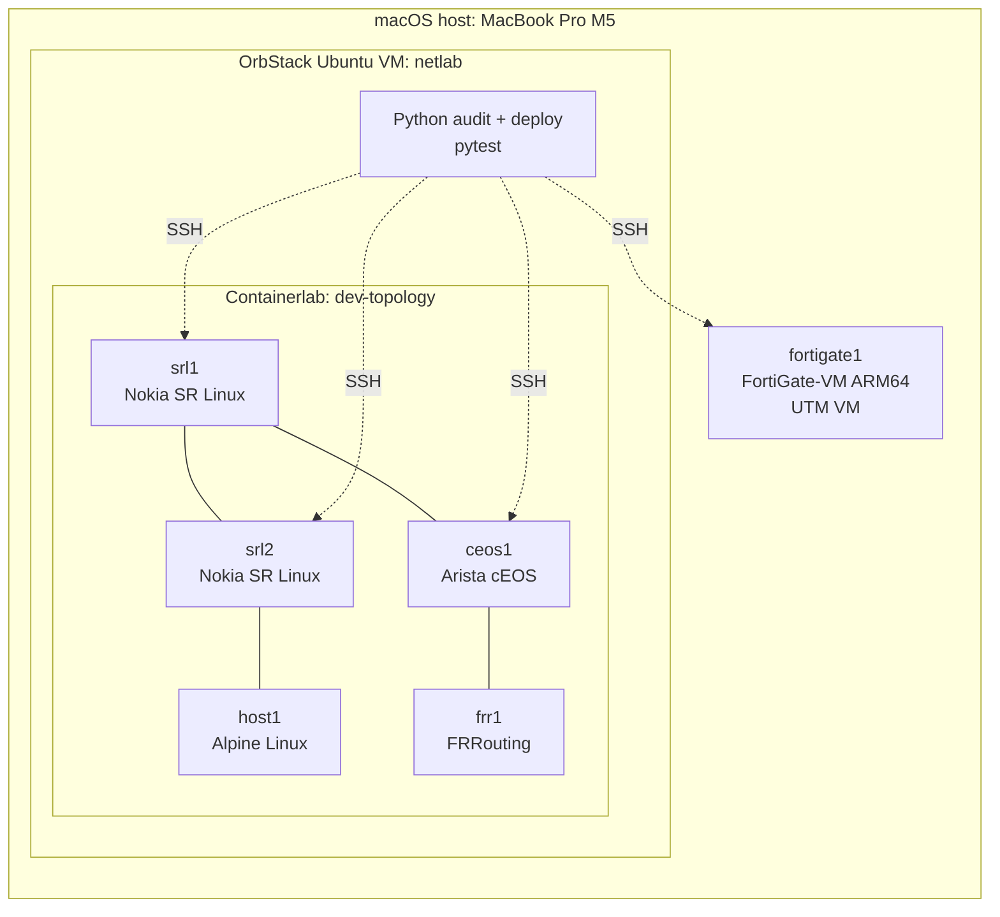

# Multi Vendor Network Compliance Audit

A network configuration audit and deployment framework, built and tested against a hybrid virtual platform of containers and VMs. It collects configuration and state from devices over SSH, extracts the relevant settings with a per platform parser, and compares them with an inventory of what each device should have. Findings are mapped to Australian Information Security Manual (ISM) controls.

**Platforms in the lab:** Arista EOS, Nokia SR Linux, Fortinet FortiOS, FRRouting, Linux.
**Platforms planned:** Juniper and Cisco (pending image access).

[](https://github.com/princesoin/illuminare-networks-network-compliance-lab/actions/workflows/ci.yml)

## Contents

- [Demo](#demo)
- [What it does](#what-it-does)
- [Example output](#example-output)
- [Architecture](#architecture)
- [The lab](#the-lab)
- [Vendor and platform coverage](#vendor-and-platform-coverage)
- [Tech stack](#tech-stack)
- [Repository layout](#repository-layout)
- [Quick start](#quick-start)
- [Adding a platform or a check](#adding-a-platform-or-a-check)
- [Testing and CI](#testing-and-ci)
- [Security model](#security-model)
- [Lab engineering notes](#lab-engineering-notes)
- [Known limitations](#known-limitations)
- [Roadmap](#roadmap)

## Demo

Video walkthrough: **recording in progress.**

**What the demo covers:**

1. The lab topology deployed with Containerlab, plus the FortiGate VM running in UTM.
2. The deploy program pushing the NTP configuration from Jinja templates, then a clean audit.
3. `python audit.py` showing PASS for both checks across Arista, Nokia and Fortinet.
4. Changing an expected NTP server in the inventory and re running to show a FAIL with both the missing and the unexpected server named.
5. Changing an expected firmware version and re running to show the firmware check failing with both versions named.
6. The saved per command evidence files, one for each device and command.

## What this platform does

1. Reads an inventory (`devices.yml`) listing each device, its platform, and the settings it is expected to have, including NTP servers and firmware version.
2. Looks up the platform in `platforms.yml`, which holds **a set of named show commands per platform**, such as `ntp` and `firmware`.
3. Connects to each device once with Netmiko and runs every command for that platform in the **same SSH session**, collecting the results into a dictionary of outputs.
4. Saves each output as its own evidence file, named after the inventory entry and the command, so evidence keeps a stable identity even when a device's IP address changes.
5. Runs each registered check. The registry says which collected output a check needs, an **extractor** for that platform pulls the actual value out of that text, and a shared comparison reports anything missing, unexpected or different.
6. Prints PASS or FAIL per device and check, and writes `master_audit_results.json`.
7. Separately, a **deploy** program renders per vendor Jinja templates and pushes configuration, so the same inventory that drives the audit also drives the fix.

Devices that time out or reject the login are listed as unreachable and skipped, so one unreachable device does not stop the run.

## Example output

A clean run across three vendors:

```
[ceos1] PASS ntp_check
[ceos1] PASS firmware_check
[srl1] PASS ntp_check
[srl1] PASS firmware_check
[srl2] PASS ntp_check
[srl2] PASS firmware_check
[fortigate1] PASS ntp_check
[fortigate1] PASS firmware_check
Unreachable devices: []
```

Deliberate failures, produced by editing the inventory so it no longer matches the device:

```
[srl1] FAIL ntp_check: ['Missing NTP Server 10.0.0.57', 'Unexpected NTP Server 10.0.0.55']
[fortigate1] FAIL firmware_check: ['Missing firmware version v8.0.1,build0245,260908', 'Unexpected firmware version v8.0.1,build0245,260909']
```

Each failure reports both sides of the mismatch, which is what an assessor needs to see. The same negative test has been run against every platform and both checks, so each extractor is shown to fail for the right reason on live devices, not only in unit tests.

## Architecture



### How a check runs

Every check has the same shape, and that is what keeps the framework small as it grows.

1. **The registry** (`ALL_CHECKS` in `checks.py`) describes each check in one place: its function, which collected command it consumes, its description, and its ISM control reference.

   ```python
   ALL_CHECKS = {
       "ntp_check": {
           "function": check_ntp,
           "command": "ntp",
           "ism_control": "ISM-0988",
           ...
       },
       "firmware_check": {
           "function": check_firmware,
           "command": "firmware",
           ...
       },
   }
   ```

2. **`run_checks` is generic.** For each registry entry, it reads the check's `command` name, picks that one text out of the outputs dictionary, and calls the check function with that text:

   ```python
   check_output = outputs[command_name]
   results[check_name] = check_function(check_output, device_vars, device_type)
   ```

3. **Every check has the same three parameter signature**: collected text, the device's expected values, and the platform key. Because `run_checks` never needs to know what a check does, adding a check means writing one module and adding one registry entry. `audit.py` and `run_checks` do not change.
4. **The check picks its extractor** from a dictionary keyed by platform, runs it on the text, and compares the result with the inventory. An unknown platform raises a clear error instead of returning a misleading empty result.

### Extract and compare

The central design decision is splitting each check into two parts.

**Extract** is vendor specific, because every platform prints the same fact differently:

| Check | Platform | Collected command | What the extractor reads |
|---|---|---|---|
| NTP | Arista EOS | `show running-config \| include ntp` | `ntp server 10.0.0.1 prefer`, `ntp server vrf MGMT 10.0.0.1` |
| NTP | Nokia SR Linux | `info flat from running / system ntp` | `set / system ntp server 10.0.0.1` |
| NTP | Fortinet FortiOS | `show system ntp` | `set server "10.0.0.1"` inside nested `config ntpserver` / `edit` blocks |
| Firmware | Arista EOS | `show version` | `Software image version: 4.35.2F-46221466.4352F (engineering build)` |
| Firmware | Nokia SR Linux | `show version` | `Software Version : v26.7.2` |
| Firmware | Fortinet FortiOS | `get system status`, filtered to the version line | A version such as `v8.0.1,build0245,260909` |

**Compare** is vendor neutral. It takes the value found and the value expected and returns findings. Adding a platform never touches it.

The two checks show two comparison shapes. NTP compares **lists** (anything missing, anything unexpected). Firmware compares **a single value** pinned in the inventory.

### Other design decisions

- **Checks return data and do not print.** Each check returns a list of findings, where an empty list means PASS. Printing and JSON output happen in the audit program, so checks are easy to unit test and the reporting layer can grow without editing any check.
- **Unsupported platforms raise an error** instead of returning an empty list, because an empty list would read as "nothing configured" and produce a false finding.
- **A dictionary maps each platform to its extractor**, so adding a platform is one new function and one new dictionary entry, with no growing `if/elif` chain.
- **Each check names the output it needs.** Commands live in `platforms.yml`, so supporting a new check on an existing platform can be a data change plus one extractor.
- **One SSH session per device**, however many commands are collected, which keeps collection fast and keeps login noise on the devices low.
- **Audit and deploy are separate programs.** The audit collects and checks. The deploy program changes configuration. Keeping them apart means the audit can be run and reviewed without any change path to a device.
- **Inventory name is the device identity**, not its address. Results and evidence stay attached to `fortigate1` even when DHCP moves the VM. Netmiko still connects by address, and the address is only used for troubleshooting messages.

### Control mapping

| Check | ISM control | What it proves |
|---|---|---|
| `ntp_check` | ISM-0988 | The device is configured to use the expected time sources, so event logs carry a consistent time. |
| `firmware_check` | ISM patching controls (control number being verified against the current ISM edition) | The device runs the firmware version recorded as approved in the inventory. |

Both checks prove **configuration and version state**, not behaviour. The NTP check does not confirm the device is actually synchronised, and the firmware check does not confirm that the approved version is free of known vulnerabilities. That would need a vulnerability source of truth, which is a planned extension.

ASD guidance expects vendor patches for network device operating systems and firmware to be applied within set timeframes, so a pinned version shows where each device stands against an approved baseline.

## The lab

A hybrid lab runs on a single MacBook Pro (M5, 16 GB). The Containerlab nodes run inside an Ubuntu VM under OrbStack, and the FortiGate runs as a separate UTM VM, bridged to the lab network.



| Node | Platform | Image | Runs as |
|---|---|---|---|
| `srl1`, `srl2` | Nokia SR Linux | `ghcr.io/nokia/srlinux` | Container |
| `ceos1` | Arista cEOS | `ceos` (ARM64 build imported from Arista) | Container |
| `frr1` | FRRouting | `quay.io/frrouting/frr` | Container |
| `host1` | Linux (Alpine) | `alpine` | Container |
| `fortigate1` | Fortinet FortiOS 8.0.1 | FortiGate-VM ARM64 KVM build | UTM (QEMU) VM |

Container images are pinned in `labs/dev/dev-topology.clab.yml`. Vendor images (cEOS, FortiGate) are licensed downloads and are not included in this repository.

## Vendor and platform coverage

| Vendor / platform | In lab topology | Audited (NTP, firmware) | Deployed via templates | Notes |
|---|---|---|---|---|
| **Arista EOS** | Yes (cEOS) | Yes, both checks | Yes | Handles `vrf` syntax and ignores `no ntp server` lines. Firmware read from `show version`. |
| **Nokia SR Linux** | Yes (2 nodes) | Yes, both checks | Yes | Flat `info flat` output; candidate and commit workflow on deploy. |
| **Fortinet FortiOS** | Yes (UTM VM) | Yes, both checks | Yes | Nested config blocks; the reason the extract/compare split exists. |
| **FRRouting** | Yes | Not yet | No | NTP runs on the host, not in FRR's config, so the NTP check is not applicable. Routing checks planned. |
| **Linux (Alpine host)** | Yes | Not yet | No | Test endpoint for the lab links. |
| **Juniper** | No | Planned | Planned | cRPD is the native ARM option. Pending image access. |
| **Cisco** | No | Planned | Planned | Most Cisco images are x86 VMs and need an x86 host. Pending image access. |

## Tech stack

| Area | Tool | Used for |
|---|---|---|
| Language | Python 3 | Collector, checks, deploy program |
| SSH automation | Netmiko | Device connections, show commands, config push |
| Inventory | PyYAML | Loading `devices.yml` and `platforms.yml` |
| Templating | Jinja2 | Per vendor configuration templates for deployment |
| Testing | pytest | Unit tests with saved, redacted device output samples |
| Linting | ruff | Error and style rules (`E`, `F`), run locally and in CI. Google docstring rules are planned. |
| CI | GitHub Actions | Runs ruff and pytest on every push and pull request |
| Lab orchestration | Containerlab | Deploying the container topology |
| Containers | Docker | Runtime for SR Linux, cEOS, FRR and Alpine nodes |
| Container host | OrbStack | Ubuntu 26.04 (arm64) Linux VM named `netlab` |
| Virtualisation | UTM (QEMU backend) | FortiGate VM, which has no container image |
| Dev environment | VS Code with Remote SSH | Editing and running code inside the Linux VM |
| Source control | Git, GitHub, GitHub CLI (`gh`) | Version control and hosting |
| History hygiene | git-filter-repo | Removing credentials and collected configs from history |
| Package management | Homebrew (macOS), pip and venv (Python) | Tooling and dependencies |
| Diagrams | Mermaid | Architecture and lab diagrams in this README |
| Host | MacBook Pro, Apple M5, 16 GB | Runs the whole lab |

**Planned:** `concurrent.futures` for threaded collection, and a timing comparison against a Java (JSch) implementation.

## Repository layout

```
.github/workflows/
  ci.yml                       GitHub Actions: ruff and pytest on every push
ruff.toml                      Lint configuration
requirements.txt               Python dependencies (used locally and by CI)
inventory/
  devices.example.yml          Example inventory (copy to devices.yml)
  platforms.yml                Per platform named commands, template folder, error patterns
labs/dev/                      Containerlab topology and device startup configs
templates/                     Jinja templates for the deploy program, one folder per vendor
scripts-dev/
  audit.py                     Collect outputs, save evidence, run checks
  checks.py                    Check registry and the function that runs every check
  check_modules/
    ntp_check.py               NTP extractors, platform dictionary, check_ntp
    firmware_check.py          Firmware extractors, platform dictionary, check_firmware
  deploy_configuration_dev.py  Render templates and push config (changes devices)
  tests/
    test_ntp_check.py          pytest tests for the NTP extractors and check
    test_firmware_check.py     pytest tests for the firmware extractors and check
evidence/                      Collected output, one file per device and command (gitignored)
```

## Quick start

Requires Python 3.10 or later, and a lab with reachable devices.

```bash
git clone https://github.com/princesoin/illuminare-networks-network-compliance-lab.git
cd illuminare-networks-network-compliance-lab
python3 -m venv .venv
source .venv/bin/activate
pip install -r requirements.txt

cp inventory/devices.example.yml inventory/devices.yml
# Edit devices.yml: set each device's address and credentials.
```

Run the tests:

```bash
cd scripts-dev
python -m pytest -v
```

Run the audit:

```bash
cd scripts-dev
python audit.py
```

Run the deploy program (**this changes device configuration**):

```bash
cd scripts-dev
python deploy_configuration_dev.py
```

`inventory/devices.yml` is gitignored and must never be committed, because it holds credentials.

### Inventory format

Each device has connection details (passed straight to Netmiko) and `vars` describing the state it should be in:

```yaml
srl1:
  connection:
    device_type: nokia_srl
    host: <address or hostname>
    username: <user>
    password: <password>
  vars:
    hostname: srl1
    ntp_servers:
      - 10.0.0.55
    firmware_version:
      - v26.7.2
```

For Arista, an NTP entry such as `10.0.0.126 prefer` is accepted. The audit compares only the address, and the deploy template uses the full entry. Firmware versions are written exactly as the device prints them, so there is no translation step to get wrong.

### Platform commands

`platforms.yml` holds a named set of commands for each platform. The names are the keys a check asks for.

```yaml
arista_eos:
    collect_command:
        ntp: show running-config | include ntp
        firmware: show version

nokia_srl:
    collect_command:
        ntp: info flat from running / system ntp
        firmware: show version
```

## Adding a platform or a check

**A new platform for an existing check** (for example, Juniper)

1. Write the platform's extractor in the check's module, for example `extract_firmware_<platform>(output)`. It takes the collected text and returns the value.
2. Add it to that check's platform dictionary, keyed by the Netmiko `device_type`.
3. Add the platform to `inventory/platforms.yml` with a command for every check, plus its template folder and error pattern.
4. Add tests with a redacted sample of the real output, including the awkward lines.

**A new check** (for example, logging)

1. Create `check_modules/<name>_check.py` with its extractors, a platform dictionary and a `check_<name>` function that returns a list of findings.
2. Add the command it needs under each platform in `platforms.yml`.
3. Register it in `ALL_CHECKS` in `checks.py` with the command name, description and control reference.

`audit.py` and `run_checks` do not change for either case.

## Testing and CI

Tests feed saved sample device output to the extractors and assert on the returned values, one test per case. The suite covers:

- **NTP extraction on all three platforms**, including FortiOS quoting, Arista `vrf` lines, and `no ntp server` lines that must be ignored.
- **Awkward input**: bare keywords with no address, extra words after an address, hostnames in place of addresses, and FortiOS `server-mode` lines that must not be mistaken for server entries.
- **Check logic**: PASS and FAIL cases for the NTP check on every platform, using the exact finding text.
- **Firmware extraction and checks** on Arista and Nokia, using real `show version` output, with PASS and FAIL cases. The Arista sample includes a second version line that must be ignored, which proves the extractor reads the right one.
- **Unknown platform** raises `ValueError` instead of returning a misleading result.

Beyond unit tests, the audit has been verified end to end against the live lab. Matching state passes, and a deliberately wrong inventory entry fails with both sides of the mismatch named, on every platform and for both checks.

Samples are hand written or redacted. No real device output, serial numbers or credentials are committed.

### Continuous integration

Every push to `main`, and every pull request, runs a GitHub Actions workflow (`.github/workflows/ci.yml`) on a clean Ubuntu runner:

1. Check out the repository.
2. Install Python and the packages in `requirements.txt`.
3. Lint with `ruff check .`.
4. Run `python -m pytest -v` from `scripts-dev`.

The runner has no route to the lab and no `devices.yml`, so CI exercises the parsers and check logic against the sample text only. It cannot audit real devices, which is why the samples are kept close to real device output. The workflow needs no secrets.

Run the same two checks locally before pushing:

```bash
ruff check .
cd scripts-dev && python -m pytest -v
```

## Security model

- **Credentials stay out of git.** `devices.yml`, collected evidence and generated results are gitignored.
- **Evidence is treated as sensitive.** Device output such as `show version` can include serial numbers and MAC addresses, so it is saved to a gitignored folder and never committed. Where a full output would expose a serial number, the collect command is filtered to the line needed.
- **History was cleaned.** An earlier inventory file and some collected configs were removed from the full git history with git-filter-repo, and the repository was force pushed.
- **Audit and deploy are separate programs** with different intent: one only reads, one writes.
- **Samples are redacted** before they are committed. Hostnames derived from device serial numbers are replaced.
- **Lab devices use default or weak credentials** and stay on private networks only.

Do not run this tool against devices you are not authorised to audit.

## Lab engineering notes

Getting a mixed container and VM lab working on Apple silicon surfaced several constraints, recorded here because they decide which tools can run where.

- **No `/dev/kvm` in OrbStack.** Only container based nodes can run in the netlab VM, so VM based images cannot run there.
- **ARM64 container network OSes** are limited to SR Linux, cEOS, FRR and Juniper cRPD. Most others (Cisco, Palo Alto, vSRX) are x86 VMs and need an x86 host.
- **FortiGate runs as a standalone UTM VM** with the QEMU backend. Running the ARM FortiGate nested inside a Linux VM under KVM hung after the UEFI handoff in testing, while the non nested UTM VM boots normally.
- **vrnetlab is amd64-only**, so it cannot build the VM based nodes on an ARM host (looking into alternatives).
- **FortiGate evaluation licence limits** apply (1 vCPU, 2 GB RAM). Exceeding them invalidates the licence.
- **cEOS is not on Docker Hub.** The ARM64 image is downloaded from Arista and imported with `docker import`.
- **The FortiGate's address changes** when its DHCP lease changes, which is why results and evidence are keyed by inventory name and not by address.

These findings are intended as a write up for the Containerlab and vrnetlab communities.

## Known limitations

- **Both checks prove configuration and version state**, not behaviour. The NTP check does not confirm time synchronisation, and the firmware check does not confirm the pinned version is free of known vulnerabilities.
- **Firmware is an exact match** against the inventory. A rebuilt image with the same release but a different build string fails the check. Minimum version rules would need proper version comparison.
- **Collection is filtered per check.** Each check collects only the command it needs, so evidence is a set of targeted outputs and not a full configuration. Full config collection is planned.
- **A command missing from a platform stops the run.** Adding a check without adding its command for every platform raises an error that halts the audit, instead of being reported for that device.
- **Paths are hardcoded** in the scripts and will move to `pathlib`.
- **Result states are pass and fail only.** "Not applicable" (for example NTP on FRR) and "error" are not yet distinguished.
- **An unsupported platform stops the whole audit** rather than being reported for that device alone.
- **Lint coverage is partial.** Ruff runs the `E` and `F` rules with long line checks off. Docstring rules are not enforced yet.
- **FortiOS firmware is verified on the live lab.** Its extractor does not yet have unit test coverage in CI, because the FortiGate cannot run in CI.

## Roadmap

- [x] NTP check on Arista EOS, Nokia SR Linux and FortiOS
- [x] Firmware version check on Arista EOS, Nokia SR Linux and FortiOS
- [x] Per platform extractors with a shared comparison
- [x] Check registry with per check command routing, one SSH session per device
- [x] Per command evidence files keyed by inventory name
- [x] Unit tests for extractors, check logic and platform dispatch
- [x] Hybrid lab: containers plus a FortiGate VM
- [x] Separate audit and deploy programs with Jinja templates
- [x] GitHub Actions running pytest and ruff on every push
- [ ] FortiOS firmware extractor tests from a redacted sample
- [ ] Result states: pass, fail, not applicable, error, with per device and per check error handling
- [ ] Full config collection and evidence metadata (timestamp, firmware version, collect command)
- [ ] Logging and Telnet/SSH checks
- [ ] Juniper and Cisco platform support (pending images)
- [ ] Threaded collection and a timing comparison with a Java (JSch) implementation
- [ ] AI layer that explains findings and drafts remediated configuration from structured results.

## Author

Prince Soin.